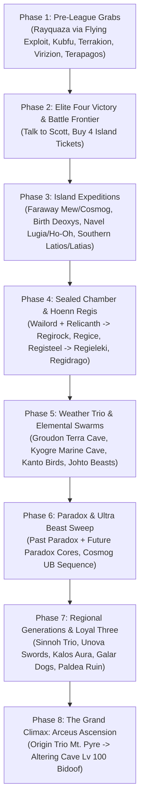

# Pokémon Quetzal: Master Legendary & Mythical Encounter Guide
**Definitive Post-Game Strategy, Event Mechanics, Party-Type Optimization & Route Execution**

---

## 1. Executive Summary & Engine Architecture

**Pokémon Quetzal** (by TenmaRH, based on `pokeemerald`) expands the Emerald experience with Pokémon, moves, and mechanics up to Generation IX (Paldea), full multi-avatar customization, and over 104 Legendary and Mythical encounters directly accessible within the Hoenn campaign map and its ticket islands.

Unlike vanilla Pokémon Emerald where encounters are largely static sprites awaiting interaction, Quetzal employs an **Event Script State & Party-Condition Validation Engine**. Overworld legendary spawns evaluate:
1. **Active Party Composition**: Type prerequisites, specific species order, gender, moves known, and status ailments.
2. **Avatar / Protagonist Identity**: Set via `Options -> Player` menu at any time (e.g., Gold, Leaf, Lucas/Dawn/Cynthia, N, Calem/Serena, Elio/Selene, Galar Protagonists, Paldea Protagonists, or even specific Pokémon via *Play as Pokémon*).
3. **Story Flag Milestones**: Pre-League accessibility vs. Post-Champion / Battle Frontier unlocking (specifically talking to Scott at the Battle Frontier to unlock late-game triggers).
4. **Altering Cave (Route 103) Legendary Chamber**: In the post-game, entering the cave on Route 103 while playing as a previously captured Legendary Pokémon spawns duplicate/respawn encounters of that species, solves counterpart evolution locks (e.g., obtaining both Solgaleo and Lunala, or dual Urshifu forms), and serves as the ultimate summoning circle for Arceus.

---

## 2. Universal Core Mechanics & Traversal Exploits

### 2.1 The "Play as Pokémon" Flight Exploit
* **Menu Path**: `Options -> Player -> Select Pokémon`
* **Mechanics**: Transforming your overworld character into **Aerodactyl, Walking Wake, or any Flying-type Pokémon** grants true flight over terrain obstacles.
* **Exploits**:
  - **Sky Pillar**: Completely bypasses cracked floor tiles without requiring the high-speed Mach Bike puzzle.
  - **Mirage Tower**: Fly straight over crumbling rock floors.
  - **Water Traversal**: Traverse water bodies without manually calling Surf (requires the Balance Badge).
  - **Mow Rotom Field Hack**: Playing as Mow Rotom (or placing Mow Rotom first in your party) automatically cuts all tall grass as you walk.

### 2.2 On-Demand Move Relearner
* Quetzal allows moves (e.g., *Wish*, *Moonlight*, *Toxic*, *Sweet Scent*, *Scald*, *Thief*, *Sing*, *Tera Blast*, Terrains) to be relearned or taught directly from each Pokémon's summary screen without Move Tutors or Heart Scales.

### 2.3 Battle Frontier Key Item Shop
Located in the shop directly adjacent to the Pokémon Center in the Battle Frontier (unlocked by defeating the Elite Four and speaking to Scott):
* **Old Sea Map** (100,000 Poké Dollars) -> Faraway Island (Mew, Cosmog)
* **Aurora Ticket** (100,000 Poké Dollars) -> Birth Island (Deoxys, Necrozma)
* **Mystic Ticket** (100,000 Poké Dollars) -> Navel Rock (Lugia, Ho-Oh)
* **Eon Ticket** (100,000 Poké Dollars) -> Southern Island (Latios, Latias)

---

## 3. Hoenn Native Legendaries & Mythicals Walkthrough

### 3.1 The Weather Trio
| Pokémon | Level | Location | Pre-requisites & Encounter Mechanics |
| :--- | :---: | :--- | :--- |
| **Rayquaza** | 70 | **Sky Pillar** (Route 131) | • **Timing**: Accessible **Pre-League** after Sootopolis story events.<br>• **Floor Puzzle**: Requires Mach Bike (build up 3 tiles of momentum before cracked floors) **OR** switch avatar to Aerodactyl / Flying Pokémon to fly over cracked panels.<br>• Awaits at the rooftop summit. |
| **Groudon** | 70 | **Terra Cave** (Routes 114, 115, 116, or 118) | • **Timing**: Post-League.<br>• Speak to the Weather Institute scientist on Route 119 (top floor). He reports extreme drought on a specific route.<br>• Head immediately to that route to enter the newly opened cave entrance in the rock wall. |
| **Kyogre** | 70 | **Marine Cave** (Routes 105, 125, 127, or 129) | • **Timing**: Post-League.<br>• Speak to the Weather Institute scientist on Route 119. He reports torrential downpours on an ocean route.<br>• Travel there, find the dark dive patch, and use Dive to enter Marine Cave. |

---

### 3.2 The Regi Trio & The Sealed Chamber Puzzle
To unlock Regirock, Regice, and Registeel, you must first complete the **Sealed Chamber** sequence on Route 134:
1. **Preparation**:
   - Catch **Wailord** (Route 129 water/fishing or evolve Wailmer at Lv 40).
   - Catch **Relicanth** (Underwater routes around Mossdeep/Sootopolis via Dive in seaweed, 5% encounter rate).
   - A party Pokémon knowing **Dig** (TM28 from Fallarbor Town Fossil Maniac's brother).
   - Party members knowing **Surf** and **Dive**.
2. **Accessing Sealed Chamber**:
   - Surf west from Pacifidlog Town along the southern rapid currents of Route 134.
   - Enter the calm patch with a deep diving spot. Use Dive, follow the trench south to the Braille inscription on the stone wall, and surface.
3. **Opening the Vault**:
   - In the first chamber, stand in front of the central Braille wall and use **Dig** to create a doorway.
   - Enter the second chamber. Arrange your party slots:
     - **Slot 1 (Lead)**: **Wailord**
     - **Slot 6 (Last)**: **Relicanth**
     *(Note: In Quetzal, Wailord is Slot 1 and Relicanth is Slot 6).*
   - Read the central Braille inscription. An earthquake sounds, opening the doors across Hoenn.

#### Individual Chamber Unlocks:
* **Regirock (Level 30 - Desert Ruins, Route 111 Desert)**:
  - Bring a Pokémon with **Rock Smash**.
  - Enter the ruins at the southern end of the desert. Stand in front of the central wall inscription.
  - Walk **2 steps left, 2 steps down**, and execute **Rock Smash** without turning. The door opens.
* **Regice (Level 30 - Island Cave, Route 105)**:
  - Surf north from Dewford Town along Route 105 to the small rocky island cave.
  - Read the back wall inscription.
  - Staying flush against the perimeter wall, walk **clockwise** around the entire room until you return to the inscription. Read the inscription a second time. The door unlocks.
* **Registeel (Level 30 - Ancient Tomb, Route 120)**:
  - Bring a Pokémon with **Flash**.
  - Head to the high plateau on Route 120. Enter the tomb.
  - Stand in the exact geometric center of the chamber and use **Flash**. The door opens.

---

### 3.3 The Eon Duo (Southern Island)
* **Pre-requisite**: Defeat Pokémon League, speak to Scott to unlock the Battle Frontier, and purchase the **Eon Ticket** at the Battle Frontier Mart.
* **Latios (Level 50)**:
  - **Avatar**: Male protagonist (e.g., Brendan, Red, Lucas, etc.).
  - **Party**: Exactly **6 Male Pokémon** in the active party.
  - **Route**: Take the ferry from **Slateport City Harbor** to Southern Island. Walk to the clearing and interact with the monolith.
* **Latias (Level 50)**:
  - **Avatar**: Female protagonist (e.g., May, Leaf, Dawn, Serena, etc.).
  - **Party**: At least **5 Female Pokémon** in the active party.
  - **Route**: Board the **S.S. Tidal at Lilycove City Harbor** to travel to Southern Island. Interact with the clearing stone.
* *(Note: Post-League roaming Latios/Latias can also be chosen upon watching TV at home in Littleroot Town).*

---

### 3.4 Hoenn & Island Mythicals
* **Jirachi (Level 50)**:
  - **Party Condition**: All **6 active Pokémon must know Wish**.
  - *Tip*: Compatible Pokémon (such as Flabébé on Route 123, Togepi, Gardevoir, Pikachu line, etc.) can learn *Wish* directly via the summary menu move relearner.
  - **Location**: Mossdeep City. Interact with the sacred **White Rock** situated on the cliff above the Mossdeep Space Center.
* **Deoxys (Level 30)**:
  - **Key Item**: Purchase **Aurora Ticket** (100,000 Poké Dollars) at the Battle Frontier shop.
  - **Transport**: Travel from **Slateport City Harbor** to **Birth Island**.
  - **Triangle Puzzle**: Interact with the black triangular monolith. Follow it as it relocates across the island. Solve it by taking the most direct paths without changing direction more than twice per transit. The triangle will turn red and shatter, initiating the battle.
* **Mew (Level 30)**:
  - **Key Item**: Purchase **Old Sea Map** (100,000 Poké Dollars) at the Battle Frontier shop.
  - **Transport**: Travel from **Lilycove City Harbor** to **Faraway Island**.
  - **Mechanic**: Enter the deep jungle maze. Pursue Mew through the tall grass, corner it, and interact to battle.
* **Lugia & Ho-Oh (Level 70 each)**:
  - **Key Item**: Purchase **Mystic Ticket** (100,000 Poké Dollars) at the Battle Frontier shop.
  - **Transport**: Travel from **Lilycove City Harbor** to **Navel Rock**.
  - **Chamber Routing**:
    - **Lugia**: Inside the cave, take the **Right staircase downward**. Descend through the deep flooded chambers to the bottom basin.
    - **Ho-Oh**: Inside the cave, take the **Left staircase upward**. Ascend through the tower ruins to the open-air rooftop.

---

## 4. Complete Generational Compendium (All 104 Hoenn Encounters)

### Generation 1 (Kanto)
* **Articuno (Lv 30)**: Shoal Cave (frozen lower chamber at low tide). Requires **6 Ice-type Pokémon**. Pre-League accessible.
* **Zapdos (Lv 30)**: New Mauville / Power Plant generator room. Requires **6 Electric-type Pokémon** + Surf. Pre-League accessible.
* **Moltres (Lv 30)**: Mt. Chimney crater summit. Requires at least **5 Fire-type Pokémon**. Pre-League accessible.
* **Galarian Articuno (Lv 70)**: Route 113 (in front of Glass Workshop). Defeat/catch Kantonian Articuno first. Put Articuno in **Slot 1** + **4 Psychic-types**.
* **Galarian Zapdos (Lv 70)**: Route 110 (Rival May battle clearing under Cycling Road). Defeat/catch Kantonian Zapdos first. Put Zapdos in **Slot 1** + **4 Fighting-types**.
* **Galarian Moltres (Lv 70)**: Route 113 entrance. Defeat/catch Kantonian Moltres first. Put Moltres in **Slot 1** + **4 Dark-types**.
* **Mewtwo (Lv 70)**: Victory Road deepest cavern (enter from Pokémon League exit side). Put **Mew in Slot 1** + **5 Psychic-type Pokémon**.
* **Mew (Lv 30)**: Faraway Island via Old Sea Map (Lilycove Harbor).

### Generation 2 (Johto)
* **Raikou (Lv 30)**: Route 119 upper cliff behind Weather Institute (requires Acro Bike + Waterfall). Put **Zapdos in Slot 1** + **5 Electric-types**.
* **Entei (Lv 30)**: Jagged Pass / Magma Hideout machinery chamber. Put **Moltres in Slot 1** + **5 Fire-types**. Pre-League accessible.
* **Suicune (Lv 30)**: Route 130 island. Put **Entei in Slot 1**, **Raikou in Slot 2** + **4 Water-types**.
* **Lugia (Lv 70)**: Navel Rock (Right stairs down) via Mystic Ticket.
* **Ho-Oh (Lv 70)**: Navel Rock (Left stairs up) via Mystic Ticket.
* **Celebi (Lv 30)**: Petalburg Woods. Avatar: **Gold**. Follower setting = **3**. Party: **Suicune (Slot 1)**, **Entei (Slot 2)**, **Raikou (Slot 3)** + **3 Grass-types knowing Sweet Scent**. Trigger Sweet Scent in woods.

### Generation 4 (Sinnoh)
* **Uxie (Lv 50)**: Route 120 (lake under northern bridge). Post-League. Requires **6 Psychic-types**.
* **Mesprit (Lv 50)**: Route 120 (southern lake). Post-League. Requires **6 Psychic-types**.
* **Azelf (Lv 50)**: Route 120 (western lake). Post-League. Requires **6 Psychic-types**.
* **Dialga & Palkia (Lv 70)**: Mt. Pyre summit. Post-League. Defeat Lucas; catch Uxie, Mesprit, Azelf. Avatar: **Lucas, Dawn, or Cynthia**. Party: **At least 5 Gen 4 Pokémon (Dex 387–493)**.
* **Giratina (Lv 70)**: Mt. Pyre top floor. Defeat/catch Dialga & Palkia. Same Gen 4 party + Sinnoh avatar.
* **Heatran (Lv 50)**: Magma Hideout. Party: At least **5 Pokémon whose primary type is Fire or Steel**.
* **Regigigas (Lv 100)**: Route 133 deep underwater chamber. Party: **Regirock, Regice, Registeel, Regidrago, Regieleki all at Level 100** in Slots 1–5.
* **Cresselia (Lv 50)**: Meteor Falls deepest room (past waterfall). Party: **6 Pokémon all knowing Moonlight**.
* **Darkrai (Lv 50)**: Route 113 Grandma's Rest House. Party: **6 Dark-type Pokémon, ALL put to sleep (asleep status)**. Speak to Grandma without waking up.
* **Manaphy (Lv 30)**: Sootopolis City underwater chamber. Prerequisite: **Hatch 30 Pokémon Eggs**. Party: **5 Water-types**.
* **Phione**: Breed Manaphy + Ditto at the Route 117 Day Care.
* **Shaymin (Lv 30)**: Route 104 Pretty Petal Flower Shop. Party: **6 Grass-types all knowing Sweet Scent**. Gracidea flower purchased inside for Sky Forme.
* **Arceus (Lv 100 - The Master Event)**: Complete National Pokédex, defeat all legendary events, defeat Leaf for Poké Flute. Avatar: **Lucas/Dawn/Rei/Akari**. Party: **Origin Dialga (1), Origin Palkia (2), Origin Giratina (3) at Lv 100 + 3 Mythicals**. Play Poké Flute at Mt. Pyre summit. Then travel to **Altering Cave (Route 103)**, set party to a **single Lv 100 Bidoof**, and use **Play as Pokémon (Bidoof)** to enter the portal.

### Generation 5 (Unova)
* **Cobalion (Lv 50)**: Route 115 (Mach Bike slope). Party: At least **5 Gen 5 Steel-types**.
* **Terrakion (Lv 50)**: Route 111 Desert (Mach Bike area). Party: **Gen 5 Rock-types**. Pre-League accessible.
* **Virizion (Lv 50)**: Route 123. Party: **Gen 5 Grass-types**. Pre-League accessible.
* **Keldeo (Lv 50)**: Safari Zone. Put **Cobalion (1), Terrakion (2), Virizion (3)** + **Gen 5 Water-types**.
* **Tornadus (Lv 50)**: Route 119 riverbank. Party: **5 Gen 5 Flying-types**.
* **Thundurus (Lv 50)**: Route 119 Acro Bike rails. Party: **5 Gen 5 Electric-types**.
* **Landorus (Lv 50)**: Route 123 Berry Master's garden. Prerequisite: **Harvest/hold 100 Berries**. Party: **5 Gen 5 Ground-types**.
* **Reshiram & Zekrom (Lv 70)**: Sky Pillar summit. Defeat Rayquaza, unlock Battle Frontier. Avatar: **N**. Party: **5 Gen 5 Pokémon**.
* **Kyurem (Lv 70)**: Shoal Cave. Defeat/catch Reshiram & Zekrom. Party: **5 Gen 5 Pokémon**.
* **Meloetta (Lv 50)**: Rustboro City. Speak to Scott/unlock Battle Frontier. Party: **5 Pokémon knowing Sing**.
* **Genesect (Lv 50)**: Devon Corporation HQ (Rustboro). Party: At least **5 Fossil Pokémon** (e.g., Omanyte, Kabuto, Aerodactyl, Lileep, Anorith, Cranidos, Shieldon, etc.).
* **Victini (Lv 20)**: Slateport City lighthouse. Prerequisite: **1,000,000 Poké Dollars** in wallet. Party: **5 Fire-type Pokémon**.

### Generation 6 (Kalos)
* **Xerneas (Lv 70)**: Safari Zone. Avatar: **Calem or Serena**. Party: **5 Gen 6 Pokémon (Dex 650–721)**.
* **Yveltal (Lv 70)**: Mt. Pyre summit. Avatar: **Calem or Serena**. Party: **5 Gen 6 Pokémon**.
* **Zygarde (Lv 70)**: Battle Frontier Z-Crystal Cave. Catch Xerneas & Yveltal. Avatar: Kalos protagonist. Party: **6 Gen 6 Pokémon**. (Breed with Ditto for 10% Forme; Power Construct triggers Complete Forme below 50% HP).
* **Diancie (Lv 50)**: Granite Cave (Steven's room). Party: **5 Carbink**.
* **Hoopa (Lv 50)**: Abandoned Ship (Storage Room - requires Storage Key). Party: **5 Pokémon knowing Thief**.
* **Volcanion (Lv 50)**: Lavaridge Town hot springs. Party: **5 Pokémon knowing Scald**.

### Generation 7 (Alola & Ultra Beasts)
* **Tapu Koko (Lv 70)**: Mauville City center. Post-League. Defeat Elio on Slateport Beach. Party: **6 Pokémon knowing Electric Terrain**.
* **Tapu Lele (Lv 70)**: Mossdeep City center. Defeat Elio. Party: **6 Pokémon knowing Psychic Terrain**.
* **Tapu Bulu (Lv 70)**: Verdanturf Town center. Defeat Elio. Party: **6 Pokémon knowing Grassy Terrain**.
* **Tapu Fini (Lv 70)**: Sootopolis City center. Defeat Elio. Party: **6 Pokémon knowing Misty Terrain**.
* **Cosmog (Lv 5)**: Faraway Island bag. Avatar: **Elio or Selene**. Party: **Alolan Decidueye (1), Incineroar (2), Primarina (3) + 2 Gen 7 Pokémon**.
* **Cosmoem**: Evolve Cosmog at Lv 43.
* **Solgaleo / Lunala**: Use Sun/Shiny Stone on Cosmoem for Solgaleo; Moon/Dusk Stone for Lunala. *(Opposite box legend obtainable in Altering Cave via Play as Pokémon).*
* **Ultra Beasts Sweep (Post-League, Cosmog/Evo lead required)**:
  - **Nihilego**: Route 134 cave entrance. Cosmog lead + **Alolan Rock/Poison-types**.
  - **Buzzwole**: Route 120 (behind Cut tree with 3 Berry trees). Cosmog lead + **Alolan Bug/Fighting-types**.
  - **Pheromosa**: Route 111 Desert. Cosmog lead + **Alolan Bug/Fighting-types**.
  - **Xurkitree**: New Mauville generator. Cosmog lead + **Alolan Electric-types**.
  - **Celesteela**: Mossdeep Space Center front. Cosmog lead + **Alolan Steel/Flying-types**.
  - **Kartana**: Route 102. Cosmog lead + **Alolan Grass/Steel-types**.
  - **Guzzlord**: Abandoned Ship. Cosmog lead + **Alolan Dark/Dragon-types**.
* **Necrozma (Lv 70)**: Birth Island. Catch all Ultra Beasts first. Party: **6 Ultra Beasts**.
* **Magearna (Lv 70)**: Route 114 house. Speak to girl in Fallarbor PC, visit house, return with **5 Klink**.
* **Marshadow (Lv 50)**: Mt. Pyre top interior floor gravestone. Party: **5 Ghost-types**.
* **Zeraora (Lv 70)**: Route 103 (Cut tree past Snorlax). Post-League. Party: **Alolan Electric-types**.

### Generation 8 (Galar & Hisui)
* **Zacian (Lv 70)**: Battle Frontier - **Battle Dome**. Post-League. Avatar: **Galar protagonist (Victor/Gloria)**. Party: **6 Galar Pokémon**.
* **Zamazenta (Lv 70)**: Battle Frontier - **Battle Palace**. Post-League. Avatar: **Galar protagonist**. Party: **6 Galar Pokémon**.
* **Eternatus (Lv 70)**: Battle Frontier - **Z-Crystal Cave**. Defeat Zacian & Zamazenta. Avatar: Galar protagonist. Party: **6 Galar Pokémon**.
* **Kubfu (Lv 20)**: Fiery Path side tunnel. Party: **6 Fighting-types**. Pre-League accessible. *(Second Kubfu obtainable in Altering Cave).*
* **Urshifu**: Use **Scroll of Waters** (Rapid Strike) or **Scroll of Darkness** (Single Strike) on Kubfu.
* **Zarude (Lv 50)**: Petalburg Woods. Catch Celebi. Party: **Celebi (1) + Grass-types**.
* **Regieleki (Lv 40)**: Route 111 Desert Ruins. Party: **Regirock (1), Regice (2), Registeel (3) + 2 Electric-types**.
* **Regidrago (Lv 40)**: Route 111 Desert Ruins. Party: **Regirock (1), Regice (2), Registeel (3) + 2 Dragon-types**.
* **Glastrier (Lv 50)**: Shoal Cave. Party: **5 Gen 8 Ice-types (Dex 810–905)**.
* **Spectrier (Lv 50)**: Mt. Pyre (drop through summit hole). Party: **5 Gen 8 Ghost-types**.
* **Calyrex (Lv 70)**: Route 116. Catch Glastrier & Spectrier. Party: **Glastrier (1), Spectrier (2) + 3 Gen 8 Psychic-types**.

### Generation 9 (Paldea & Paradox Encounters)
* **Treasures of Ruin (Avatar: Gen 9 Florian/Juliana, Post-Battle Frontier)**:
  - **Wo-Chien (Lv 70)**: Petalburg Woods. Party: **5 Paldean Grass-types**.
  - **Chien-Pao (Lv 70)**: Shoal Cave bridge. Party: **5 Paldean Ice-types**.
  - **Ting-Lu (Lv 70)**: Route 111 Desert (north of Regi cave). Party: **5 Paldean Ground-types**.
  - **Chi-Yu (Lv 70)**: Magma Hideout (Groudon chamber). Party: **5 Paldean Fire-types**.
* **The Loyal Three & Ogerpon**:
  - **Okidogi (Lv 70)**: Safari Zone entrance. Post-Battle Frontier. Party: **5 Poison-types knowing Toxic**.
  - **Munkidori (Lv 70)**: Route 104 (near Petalburg Woods). Party: **5 Poison-types knowing Toxic**.
  - **Fezandipiti (Lv 70)**: Meteor Falls entrance area. Party: **5 Poison-types knowing Toxic**.
  - **Ogerpon (Lv 70)**: Route 103. Party: **Okidogi (1), Munkidori (2), Fezandipiti (3) + 2 Grass-types**.
* **Terapagos (Lv 70)**: Cave of Origin (Sootopolis City). Party: **5 Pokémon knowing Tera Blast**. Pre-League accessible.

---

## 5. Party-Type Optimization & Dual-Type Master Teams

Many legendary spawns require parties of 5 or 6 Pokémon of a specific elemental type. Because Quetzal evaluates whether every member contains the targeted type, **dual-typed Pokémon simultaneously satisfy multiple elemental criteria**.

By employing strategic dual-typed Pokémon, a player can clear numerous encounter checks across Hoenn without returning to the PC.

```
       ┌────────────────────────────────────────────────────────┐
       │             THE SWISS-ARMY FIRE / DUAL CORE            │
       └────────────────────────────────────────────────────────┘
       │ Member 1: Magcargo     ───> [FIRE] + [ROCK]            │
       │ Member 2: Camerupt     ───> [FIRE] + [GROUND]          │
       │ Member 3: Scovillain   ───> [FIRE] + [GRASS]           │
       │ Member 4: Salazzle     ───> [FIRE] + [POISON]          │
       │ Member 5: Chandelure   ───> [FIRE] + [GHOST]           │
       │ Member 6: Volcarona    ───> [FIRE] + [BUG]             │
       └────────────────────────────────────────────────────────┘
```

### 5.1 The "Fire-Core" Swiss-Army Squad
* **Slot 1**: **Magcargo** (Fire / Rock)
* **Slot 2**: **Camerupt** (Fire / Ground)
* **Slot 3**: **Scovillain** (Fire / Grass)
* **Slot 4**: **Salazzle** (Fire / Poison)
* **Slot 5**: **Chandelure** (Fire / Ghost)
* **Slot 6**: **Volcarona** (Bug / Fire)

#### Legendaries Solved with This Single Squad:
1. **Moltres**: Fulfills the 5 Fire-type requirement.
2. **Heatran**: Fulfills the 5 Fire or Steel primary type requirement.
3. **Victini**: Fulfills the 5 Fire-type requirement (bring >1M money).
4. **Entei**: Place Moltres in Slot 1 and keep the remaining 5 Fire members.
5. **Marshadow**: Swap in 4 additional Ghost duals (or keep Chandelure leading Ghost types).
6. **Alolan Bug/Fighting Checks (Buzzwole & Pheromosa)**: Volcarona satisfies the Bug requirement.

---

### 5.2 The Past Paradox Master Engine
* **Fixed Core (Slots 2–5)**:
  - **Great Tusk** (Ground / Fighting)
  - **Scream Tail** (Fairy / Psychic)
  - **Flutter Mane** (Ghost / Fairy)
  - **Brute Bonnet** (Grass / Dark)
* **Rotating Lead (Slot 1)**:
  - Slot 1 = **Cyclizar** -> Spawns **Koraidon** at Cycling Road!
  - Slot 1 = **Entei** -> Spawns **Gouging Fire** at Fiery Path!
  - Slot 1 = **Raikou** -> Spawns **Raging Bolt** at Safari Zone North!
  - Slot 1 = **Suicune** -> Spawns **Walking Wake** at Safari Zone Lake!
* *Result*: **All 4 Past Paradox Legendary encounters cleared by changing only 1 party slot!**

---

### 5.3 The Future Paradox Master Engine
* **Fixed Core (Slots 2–5)**:
  - **Iron Treads** (Ground / Steel)
  - **Iron Bundle** (Ice / Water)
  - **Iron Hands** (Fighting / Electric)
  - **Iron Jugulis** (Dark / Flying)
* **Rotating Lead (Slot 1)**:
  - Slot 1 = **Cyclizar** -> Spawns **Miraidon** at Cycling Road!
  - Slot 1 = **Virizion** -> Spawns **Iron Leaves** at Safari Zone East!
  - Slot 1 = **Terrakion** -> Spawns **Iron Boulder** at Safari Zone Breakable Rocks!
  - Slot 1 = **Cobalion** -> Spawns **Iron Crown** at Route 114 Waterfall!
* *Result*: **All 4 Future Paradox Legendary encounters cleared by changing only 1 party slot!**

---

### 5.4 The Move-Taught Universal Utility Squad
Since Quetzal allows moves to be assigned from the party menu:
1. **The Terrain Quartet (Togedemaru / Florges / Musharna / Primarina)**:
   - Teach **Electric Terrain** to 6 members -> Spawns **Tapu Koko** (Mauville).
   - Teach **Psychic Terrain** to 6 members -> Spawns **Tapu Lele** (Mossdeep).
   - Teach **Grassy Terrain** to 6 members -> Spawns **Tapu Bulu** (Verdanturf).
   - Teach **Misty Terrain** to 6 members -> Spawns **Tapu Fini** (Sootopolis).
2. **The "Wish" Sextet**:
   - Teach **Wish** to all 6 members -> Spawns **Jirachi** (Mossdeep White Rock).
3. **The "Tera Blast" Quintet**:
   - Teach **Tera Blast** to 5 members -> Spawns **Terapagos** (Cave of Origin).
4. **The "Toxic" Poison Quintet**:
   - 5 Poison Pokémon with **Toxic** -> Unlocks **Okidogi**, **Munkidori**, and **Fezandipiti** in rapid succession!

---

### 5.5 The "Regis & Titans" Progression Chain
1. **Phase 1**: Wailord (1) + Relicanth (6) + Dig user -> Unlock Sealed Chamber.
2. **Phase 2**: Rock Smash / Clockwise Walk / Flash -> Catch Regirock, Regice, Registeel.
3. **Phase 3**: Regirock (1), Regice (2), Registeel (3) + 2 Electric types -> Catch **Regieleki** (Desert Ruins).
4. **Phase 4**: Regirock (1), Regice (2), Registeel (3) + 2 Dragon types -> Catch **Regidrago** (Desert Ruins).
5. **Phase 5**: Level all 5 Regis to 100 -> Route 133 Deep Underwater Chamber -> Catch **Regigigas (Lv 100)**!

---

## 6. Step-by-Step Chronological Encounter Route



### Phase 1: Pre-League Grabs (Before 8th Gym / Champion)
1. **Rayquaza**: Switch avatar to Aerodactyl/Flying-type, ascend Sky Pillar without Mach Bike cracks, catch at Lv 70.
2. **Kubfu**: Take Fighting squad into Fiery Path side tunnel (Lv 20).
3. **Terapagos**: Teach 5 party Pokémon *Tera Blast*, enter Cave of Origin (Lv 70).
4. **Kanto Birds & Johto Beasts Starter Checks**:
   - 6 Ice-types -> Articuno (Shoal Cave).
   - 6 Electric-types -> Zapdos (New Mauville).
   - 5 Fire-types -> Moltres (Mt. Chimney) -> Entei (Magma Hideout).
5. **Unova Starters**: Terrakion (Desert) and Virizion (Route 123).

### Phase 2: Post-League & Battle Frontier Activation
1. Defeat the Pokémon League.
2. Fly to Battle Frontier, speak to **Scott** in the central plaza (activates global post-game legendary scripts).
3. Visit the Mart next to the Battle Frontier Pokémon Center. Purchase:
   - **Old Sea Map** (100k)
   - **Aurora Ticket** (100k)
   - **Mystic Ticket** (100k)
   - **Eon Ticket** (100k)

### Phase 3: Island Expeditions
1. **Slateport Harbor**:
   - Travel to **Birth Island** -> Triangle puzzle -> Catch **Deoxys** (Lv 30).
   - Set Male avatar + 6 Male party -> Travel to **Southern Island** -> Catch **Latios** (Lv 50).
2. **Lilycove Harbor**:
   - Travel to **Faraway Island** -> Grass puzzle -> Catch **Mew** (Lv 30).
   - Set Female avatar (Leaf) + 5 Female party -> Travel to **Southern Island** -> Catch **Latias** (Lv 50).
   - Travel to **Navel Rock** -> Right stairs down for **Lugia** (Lv 70), Left stairs up for **Ho-Oh** (Lv 70).
   - Set Elio/Selene + Alolan starters -> Travel to **Faraway Island** -> Grab **Cosmog** from bag!

### Phase 4: Sealed Chamber & Regis Chain
1. Take Wailord (Slot 1) + Relicanth (Slot 6) + Dig user to Route 134 dive spot. Unlock Sealed Chamber.
2. Catch Regirock (Desert), Regice (Route 105), Registeel (Route 120).
3. Insert 2 Electric-types -> Catch **Regieleki** (Desert Ruins).
4. Insert 2 Dragon-types -> Catch **Regidrago** (Desert Ruins).
5. Rare Candy / level all 5 Regis to 100 -> Route 133 trench -> Catch **Regigigas (Lv 100)**!

### Phase 5: Weather Trio & Johto / Kanto Form Sweeps
1. Weather Institute -> Terra Cave (**Groudon**) & Marine Cave (**Kyogre**).
2. Use Kantonian Birds to unlock Galarian Birds:
   - Articuno + 4 Psychic -> Galarian Articuno (Route 113).
   - Zapdos + 4 Fighting -> Galarian Zapdos (Route 110).
   - Moltres + 4 Dark -> Galarian Moltres (Route 113).
3. Put Zapdos 1st + 5 Electric -> Catch **Raikou** (Route 119).
4. Put Entei (1), Raikou (2) + 4 Water -> Catch **Suicune** (Route 130).
5. Switch to Gold avatar, follower=3, Beasts in Slots 1–3 + 3 Sweet Scent Grass-types -> Catch **Celebi** (Petalburg Woods).
6. Put Celebi 1st + Grass-types -> Catch **Zarude** (Petalburg Woods).
7. Put Mew 1st + 5 Psychic-types -> Victory Road deep cavern -> Catch **Mewtwo (Lv 70)**!

### Phase 6: Paradox & Ultra Beasts Sweep
1. Load **Past Paradox Engine**:
   - Lead Cyclizar -> **Koraidon** (Cycling Road).
   - Lead Entei -> **Gouging Fire** (Fiery Path).
   - Lead Raikou -> **Raging Bolt** (Safari Zone North).
   - Lead Suicune -> **Walking Wake** (Safari Zone Lake).
2. Load **Future Paradox Engine**:
   - Lead Cyclizar -> **Miraidon** (Cycling Road).
   - Lead Virizion -> **Iron Leaves** (Safari Zone East).
   - Lead Terrakion -> **Iron Boulder** (Safari Zone Rocks).
   - Lead Cobalion -> **Iron Crown** (Route 114 Waterfall).
3. Evolve Cosmog into Cosmoem (Lv 43) -> Solgaleo/Lunala.
4. Run Ultra Beast locations (Nihilego, Buzzwole, Pheromosa, Xurkitree, Celesteela, Kartana, Guzzlord).
5. Assemble party of 6 Ultra Beasts -> Slateport Harbor to Birth Island -> Catch **Necrozma (Lv 70)**!

### Phase 7: Regional Generations & The Loyal Three
1. **Sinnoh Lake Trio**: 6 Psychic-types -> Uxie, Mesprit, Azelf (Route 120).
2. **Sinnoh Box Trio**: Defeat Lucas. Switch to Lucas/Dawn/Cynthia + 5 Gen 4 Pokémon -> Dialga, Palkia, Giratina (Mt. Pyre).
3. **Darkrai**: 6 Dark-types all Asleep (via Rest) -> Route 113 Grandma's Inn.
4. **Kalos Trio**: Switch to Calem/Serena + Gen 6 team -> Xerneas (Safari Zone), Yveltal (Mt. Pyre), Zygarde (Z-Crystal Cave).
5. **Galar Box Trio**: Switch to Galar avatar + Galar team -> Zacian (Battle Dome), Zamazenta (Battle Palace), Eternatus (Z-Crystal Cave).
6. **Paldea Treasures of Ruin**: Switch to Florian/Juliana -> Wo-Chien, Chien-Pao, Ting-Lu, Chi-Yu.
7. **The Loyal Three**: 5 Poison-types with Toxic -> Okidogi (Safari Zone), Munkidori (Route 104), Fezandipiti (Meteor Falls).
8. **Ogerpon**: Okidogi (1), Munkidori (2), Fezandipiti (3) + 2 Grass-types -> Route 103 (Lv 70).

### Phase 8: The Grand Climax: The Arceus Ascension
1. Complete all National Pokédex registrations and defeat all prior legendary events.
2. Defeat Leaf to obtain the **Poké Flute**.
3. Set avatar to **Lucas, Dawn, Rei, or Akari**.
4. Assemble party of 6 Level-100 Pokémon:
   - Slot 1: **Origin Forme Dialga** (Lv 100)
   - Slot 2: **Origin Forme Palkia** (Lv 100)
   - Slot 3: **Origin Forme Giratina** (Lv 100)
   - Slots 4–6: **3 Mythical Pokémon** (Lv 100)
5. Climb to the top of Mt. Pyre. Play the **Poké Flute**.
6. Fly to Route 103. Enter **Altering Cave**.
7. In the menu:
   - Reduce party to a **single Level-100 Bidoof**.
   - Set `Options -> Player -> Play as Pokémon -> Bidoof`.
8. Step into the Legendary Cave portal. Battle and capture **Arceus (Level 100)**!

---

## 7. Multi-Region Special Appendix (Kanto / Johto Modes)

For save files configured to run or branch into alternate game regions:
* **Pecharunt (Lv 70 - Kanto)**: Two Island. Put Okidogi (1), Munkidori (2), Fezandipiti (3) holding Pecha Berries + 3 Poison-types.
* **Enamorus (Lv 70 - Kanto/Johto)**:
  - *Kanto*: Earn 8 Kanto Badges; Route 25 (Bill's house) with 1 Fairy/Flying + 5 Fairy-types.
  - *Johto*: Johto National Park. Tornadus (1), Thundurus (2), Landorus (3) + 3 Female Fairy-types.
* **Poipole (Lv 20 - Johto)**: New Bark Town (Prof. Elm's Lab). Full party of 6 different Poison-types.
* **Blacephalon (Lv 70 - Johto)**: Route 35. Cosmog/Evo in Slot 1 + 5 Pokémon knowing Explosion, Self-Destruct, or Misty Explosion.

---

## 8. Summary Checklist for Legendary Hunters

| Category | Primary Requirements | Quick-Switch Action |
| :--- | :--- | :--- |
| **Mach Bike Floor Skips** | Sky Pillar cracked tiles | Set `Options -> Player` to Aerodactyl / Flying Pokémon |
| **Sealed Chamber Open** | Wailord (Slot 1), Relicanth (Slot 6), Dig | Route 134 diving trench |
| **All Paradox Legends** | 4 Past Paradox OR 4 Future Paradox | Rotate only Slot 1 (Cyclizar, Beasts, Swords) |
| **All Island Tickets** | Battle Frontier Shop (400,000 Total) | S.S. Tidal Lilycove / Slateport Harbors |
| **Terrain Tapus** | 6 Pokémon with respective Terrain move | Relearn from party summary menu on demand |
| **Avatar Checks** | Specific protagonists required | Change instantly in `Options -> Player` menu |
| **Legendary Cloning** | Post-game Altering Cave (Route 103) | Enter while playing as that Legendary |
| **Ultimate Encounter** | Arceus (Level 100) | Origin Trio Mt. Pyre flute -> Altering Cave as Lv 100 Bidoof |
